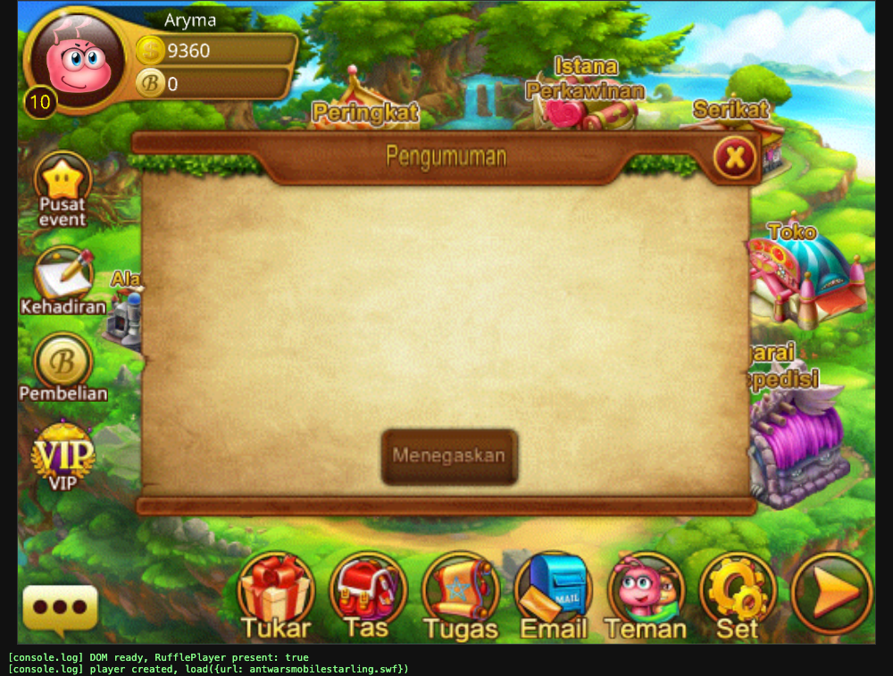

# Perjuangan Semut — Ant Wars Offline Emulator

> Revival project for the classic Indonesian **Perjuangan Semut / Ant Wars** game. It runs the original AS3/Starling client locally and emulates the game services so the world, character, inventory, quests, friends, chat, and battles can be explored without the original online servers.



This is a preservation and research project for an old social RPG: create a semut character, enter the lobby, customize equipment, complete walkthrough quests, meet other players, chat, and fight robots/PvE stages against a local emulator backend.

## Why this project is interesting

- Original Flash/AIR game client with a colorful island lobby and classic social-game UI.
- Offline local server emulator: HTTP gateway, GameServer, BattleServer, and CopyServer.
- SQLite persistence for users, authentication, equipment, quests, friendships, chat, and economy.
- Admin dashboard for inspecting users, goods, quests, stages, monsters, guilds, and rewards.
- Decompiled AS3 source and extracted assets are included for preservation and further modding.
- No external image CDN is required for game assets; the emulator serves local atlas crops and avatars.

## Quick start

### Requirements

- macOS (the native AIR launcher and browser streaming bridge target macOS)
- Python 3.10+
- Harman AIR SDK 51.x for native client execution
- Optional: Docker for running only the emulator services

The AIR SDK is intentionally not committed because it is large and redistributable separately. Put it at:

```text
emulator/sdk/AIRSDK51/
```

### Run the native game

```bash
git clone https://github.com/Aryma-f4/antwars-emulator.git
cd antwars-emulator/emulator
python3 emulator.py
```

In a second terminal:

```bash
cd antwars-emulator/emulator
./run.sh
```

`run.sh` starts the emulator if needed, seeds the local AIR login state, and launches the patched client through ADL. The game connects to:

| Port | Service |
|---:|---|
| 8080 | HTTP gateway, assets, auth, admin API |
| 9001 | GameServer |
| 9002 | BattleServer |
| 9003 | Copy/PvE server |

### Run with Docker

```bash
cd emulator
docker compose up -d --build
docker compose logs -f emulator
```

Docker runs the backend only. The AIR client still needs to run on the host because it requires Stage3D/GPU access.

## Admin dashboard

Open [http://127.0.0.1:8080/admin](http://127.0.0.1:8080/admin).

Default local credentials:

```text
Email:    admin@local.test
Password: admin12345
```

Set `ADMIN_EMAIL` and `ADMIN_PASSWORD` before the first start if you want different credentials.

## What can be played

1. Enter the island lobby and inspect the player/avatar.
2. Open the bag and equip or unequip goods.
3. Complete the initial walkthrough quests.
4. Search, add, accept, and remove friends.
5. Send chat messages with persisted history and timestamps.
6. Join robot battles and local PvE copy stages.
7. Manage users, equipment, quests, monsters, stages, guilds, and rewards from the admin dashboard.

## Browser streaming mode

The game client remains native, but its window can be streamed to a browser:

```bash
cd emulator
./web.sh
```

Then open [http://127.0.0.1:8090](http://127.0.0.1:8090). macOS may require Screen Recording and Accessibility permissions for the terminal application.

## Database

The emulator uses SQLite at `emulator/data/db.sqlite3` during local development. Runtime database files are ignored by Git so personal accounts and chat history are not uploaded. The schema and migration logic live in [emulator.py](emulator/emulator.py).

## Development and tests

From the repository root:

```bash
python3 -m py_compile emulator/emulator.py
python3 -m unittest emulator/test_auth.py emulator/test_friendships.py emulator/test_chat_identity.py emulator/test_quests.py emulator/test_equipment.py emulator/test_avatar_render.py emulator/test_equipment_actions.py emulator/test_quest_wire.py emulator/test_backpack_source.py -q
```

The decompiled client source is in [antwarsmobilestarling.swf-decompile](antwarsmobilestarling.swf-decompile), while extracted Android/decompilation material is kept under [resources](resources), [sources](sources), and [decompiled](decompiled).

## Notes

This is an offline emulator and preservation project, not the original production service. It does not connect to the original game servers or payment systems. Please use it for local testing, research, and nostalgia.

If this revival helps you remember the old game, consider giving the repository a ⭐ and sharing it with other Perjuangan Semut players.

